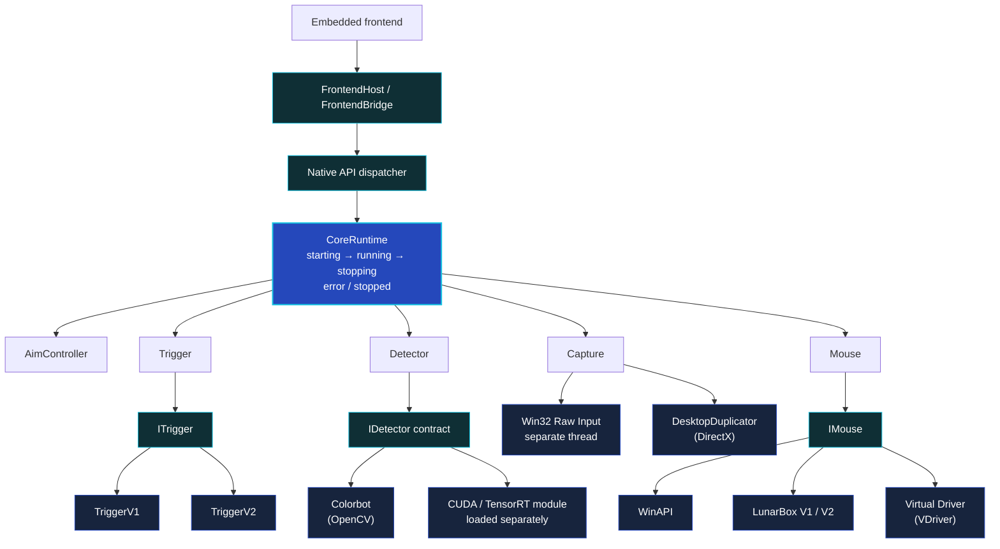

<p align="center">
  <a href="https://t.me/lunaraim2">
    
  </a>
</p>

<p align="center">
  <a href="https://t.me/in_the_skyyy"></a>
  <a href="https://t.me/lunaraim"></a>
  <a href="https://t.me/lunaraim2"></a>
</p>

<p align="center"><a href="README.md">English</a> · <a href="README.ru-RU.md">Русский</a> · <a href="README.zh-CN.md">简体中文</a></p>

<h3 align="center">Built with</h3>

<p align="center">
  <a href="https://developer.microsoft.com/en-us/microsoft-edge/webview2/"></a>
  <a href="https://learn.microsoft.com/en-us/windows/win32/"></a>
  <a href="https://cmake.org/"></a>
  <a href="https://visualstudio.microsoft.com/vs/features/cplusplus/"></a>
  <a href="https://developer.nvidia.com/cuda-toolkit"></a>
  <a href="https://developer.nvidia.com/tensorrt"></a>
  <a href="https://pytorch.org/"></a>
  <a href="https://github.com/ultralytics/ultralytics"></a>
</p>

<details>
<summary>Table of contents</summary>
<br>

- [What this repository shows](#what-this-repository-shows)
- [Architecture](#architecture)
  - [Runtime boundaries](#runtime-boundaries)
  - [What is new](#what-is-new)
- [Interface gallery](#interface-gallery)
  - [Runtime dashboard](#runtime-dashboard)
  - [Detector configuration](#detector-configuration)
  - [Runtime tooling](#runtime-tooling)
- [Detection experiment](#detection-experiment)
- [Public / private boundary](#public--private-boundary)
- [Materials](#materials)

</details>

> A public-facing technical overview of Lunar V2: its runtime boundaries, frontend integration model, visual language, and computer-vision experiment. The production application and implementation remain private.

## What this repository shows

LunarAim 2.2 is a native Windows application organized around a small, observable runtime core. The interface is treated as a client of the backend through a structured bridge, while platform-specific input and GPU functionality stay behind explicit boundaries.

- **CoreRuntime** coordinates startup, execution, shutdown, configuration, snapshots, and telemetry.
- **Frontend Bridge** exposes a structured native API to the embedded UI.
- **Composable contracts** keep aim, detection, triggering, and mouse output replaceable.
- **Isolated platform modules** separate Win32 Raw Input from the CUDA / TensorRT runtime.
- **Operator tooling** surfaces runtime health, performance, configuration, filters, binds, and logs.

## Architecture



### Runtime boundaries

The runtime is split into explicit boundaries so each part can evolve without pulling implementation details into the layers above it.

- **`CoreRuntime`.** Owns the lifecycle, worker thread, configuration path, state snapshots, and performance telemetry.
- **`FrontendBridge`.** Translates UI requests into a stable native API through dispatchers and handlers.
- **`IDetector`.** Decouples aim logic from the detector implementation, including Color and CUDA paths.
- **`ITrigger`.** Decouples runtime orchestration from the activation mechanism.
- **`IMouse`.** Decouples application logic from the way mouse commands are emitted.
- **Raw Input module.** Keeps Win32 input collection on its own thread and state boundary.
- **CUDA runtime module.** Keeps CUDA / TensorRT dependencies outside the main executable through a separately loaded module.

### What is new

LunarAim 2.2 brings the main runtime concerns into a single, observable flow. The embedded frontend communicates through a structured bridge instead of reaching into internal implementation details, while `CoreRuntime` gives startup, execution, shutdown, and error handling one visible lifecycle.

The runtime contracts make the system easier to extend: aim control, detection, triggering, and mouse output can be replaced independently. Platform-specific work is isolated as well — Win32 Raw Input runs behind its own state boundary, and CUDA / TensorRT is loaded as a separate GPU module rather than becoming a hard dependency of the main executable.

Configuration, runtime snapshots, performance telemetry, and logs are exposed as first-class parts of the operator experience. This keeps the UI focused on the current state of the system while leaving the underlying implementations behind clear interfaces.

## Interface gallery

The UI is designed as an operations surface for the runtime, with dedicated views for health, detection, input behavior, and diagnostics.

### Runtime dashboard

The dashboard makes runtime state, active configuration, frame timing, FPS, and telemetry immediately visible.

<p align="center">
  
  
</p>

### Detector configuration

<p align="center">
  
  
</p>

### Runtime tooling

<p align="center">
  
  
</p>

<details>
<summary>Additional interface screens</summary>
<br>

<p align="center">
  
  
  
  
</p>
</details>

## Detection experiment

The repository includes a small, shareable snapshot of the CS2 detector experiment:

- 127 gameplay demos were labeled.
- The model was trained for 150 epochs.
- Training curves, label statistics, and spatial distributions are included for inspection.
- The resulting `yolo11n_cs2.pt` checkpoint is provided as an experiment artifact.

<p align="center">
  
</p>

<p align="center">
  
  
</p>

## Public / private boundary

This is a **showcase repository**, not the Lunar V2 source distribution. It contains the materials that can be shared publicly: architecture notes, design documentation, interface captures, and selected ML artifacts. Private runtime code, production integrations, credentials, and proprietary infrastructure are intentionally excluded.

<details>
<summary>Repository layout</summary>
<br>

```text
.
├── assets/
│   ├── brand/          # logos and presentation cover
│   └── screenshots/    # named UI captures
├── docs/               # presentation and public project notes
├── experiments/
│   └── yolo-cs2/       # detector metrics, plots, and checkpoint
└── README.md
```

</details>

## Materials

- [Architecture and project presentation](docs/Lunar.pdf)
- [Project description](docs/project-description.md)
- [Interface screenshots](assets/screenshots/)
- [CS2 detector experiment](experiments/yolo-cs2/)

<br>

<div align="center">
  <picture>
    <source media="(prefers-color-scheme: dark)" srcset="assets/brand/LunAimW.svg">
    <source media="(prefers-color-scheme: light)" srcset="assets/brand/LunAimB.svg">
    
  </picture>
  <h2>LunarAim 2.2</h2>
  <sub>Native runtime architecture · structured UI bridge · GPU-ready detection</sub>
</div>
