<div align="center">
  <picture>
    <source media="(prefers-color-scheme: dark)" srcset="assets/brand/LunAimW.svg">
    <source media="(prefers-color-scheme: light)" srcset="assets/brand/LunAimB.svg">
    
  </picture>

  <h1>LunarAim 2.2</h1>
  <p><strong>Native runtime architecture · structured UI bridge · GPU-ready detection</strong></p>
  <p>
    <a href="docs/Lunar.pdf">Project deck</a> ·
    <a href="#architecture">Architecture</a> ·
    <a href="#interface">Interface</a> ·
    <a href="#gallery">UI gallery</a>
  </p>
</div>

<br>

<p align="center">
  <a href="https://t.me/lunaraim2">
    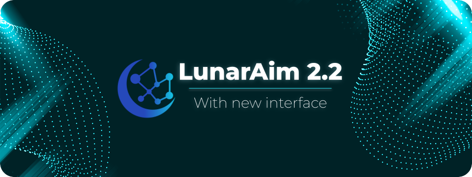
  </a>
</p>

<p align="center">
  <a href="https://t.me/in_the_skyyy"></a>
  <a href="https://t.me/lunaraim"></a>
  <a href="https://t.me/lunaraim2"></a>
</p>

> A public-facing technical overview of Lunar V2: its runtime boundaries, frontend integration model, visual language, and computer-vision experiment. The production application and implementation remain private.

## What this repository shows

LunarAim 2.2 is a native Windows application organized around a small, observable runtime core. The interface is treated as a client of the backend through a structured bridge, while platform-specific input and GPU functionality stay behind explicit boundaries.

- **CoreRuntime** coordinates startup, execution, shutdown, configuration, snapshots, and telemetry.
- **Frontend Bridge** exposes a structured native API to the embedded UI.
- **Composable contracts** keep aim, detection, triggering, and mouse output replaceable.
- **Isolated platform modules** separate Win32 Raw Input from the CUDA / TensorRT runtime.
- **Operator tooling** surfaces runtime health, performance, configuration, filters, binds, and logs.

## Architecture

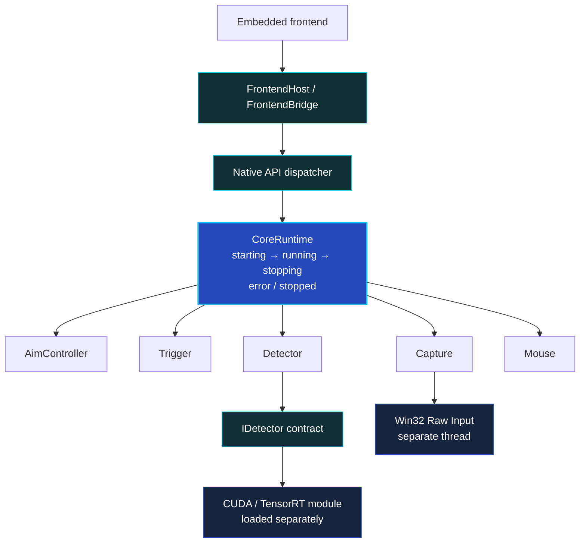

### Runtime boundaries

| Boundary | Responsibility |
| --- | --- |
| `CoreRuntime` | Owns lifecycle, worker thread, configuration path, state snapshots, and performance telemetry. |
| `FrontendBridge` | Translates UI requests into a stable native API through dispatchers and handlers. |
| `IDetector` | Decouples aim logic from the detector implementation, including Color and CUDA paths. |
| `ITrigger` | Decouples runtime orchestration from the activation mechanism. |
| `IMouse` | Decouples application logic from the way mouse commands are emitted. |
| Raw Input module | Keeps Win32 input collection on its own thread and state boundary. |
| CUDA runtime module | Keeps CUDA / TensorRT dependencies outside the main executable through a separately loaded module. |

## From tightly coupled to explicit contracts

The architecture addresses the main limitations of the previous system:

| Before | After |
| --- | --- |
| UI reached into internal implementation details | UI communicates through `FrontendBridge` and a structured API |
| Configuration was an unstructured JSON blob | Configuration is handled through dedicated runtime/configuration boundaries |
| Start, stop, and restart logic was spread across the codebase | `CoreRuntime` owns a visible lifecycle: `starting → running → stopping` |
| CUDA / TensorRT affected the whole executable build | GPU functionality is isolated behind a dynamically loaded runtime module |
| Concrete implementations were hard to replace | `IAimController`, `IDetector`, `ITrigger`, and `IMouse` define seams for substitution |
| Logs and metrics were ad hoc | Runtime snapshots, telemetry, and a dedicated log view make behavior observable |

## Interface

The UI is designed as an operations surface for the runtime rather than a collection of disconnected settings pages.

<p align="center">
  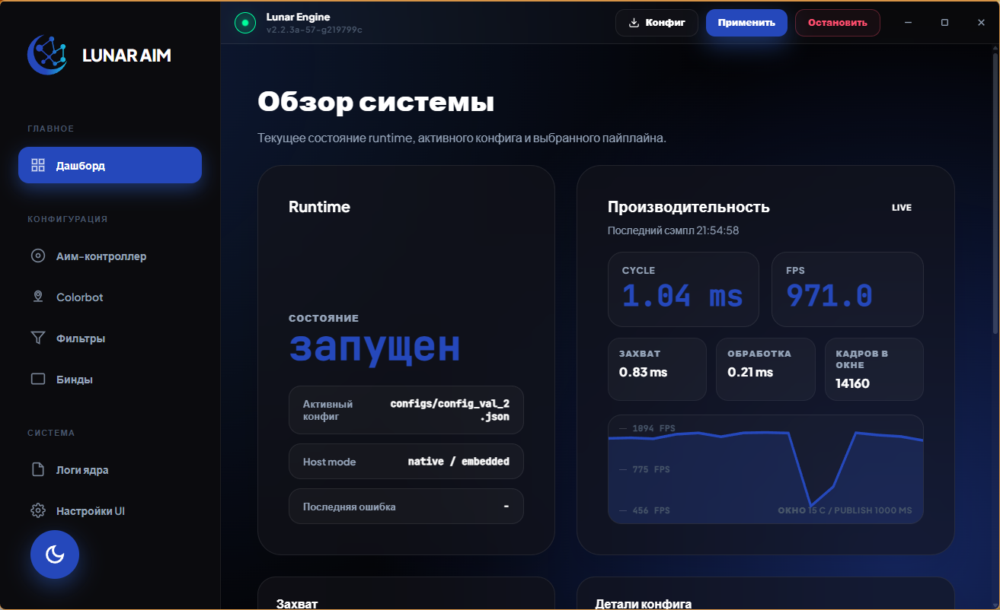
  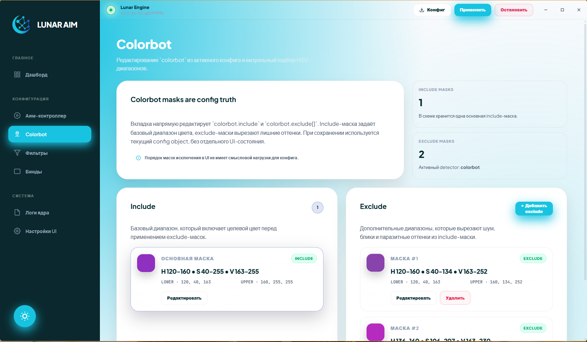
</p>

The dashboard makes the runtime state, active configuration, frame timing, FPS, and telemetry immediately visible. Other views cover detector setup, filters, binds, and core logs.

## Gallery

<p align="center">
  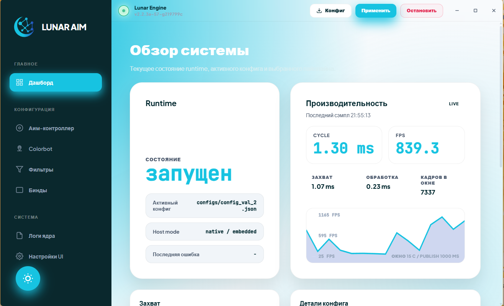
  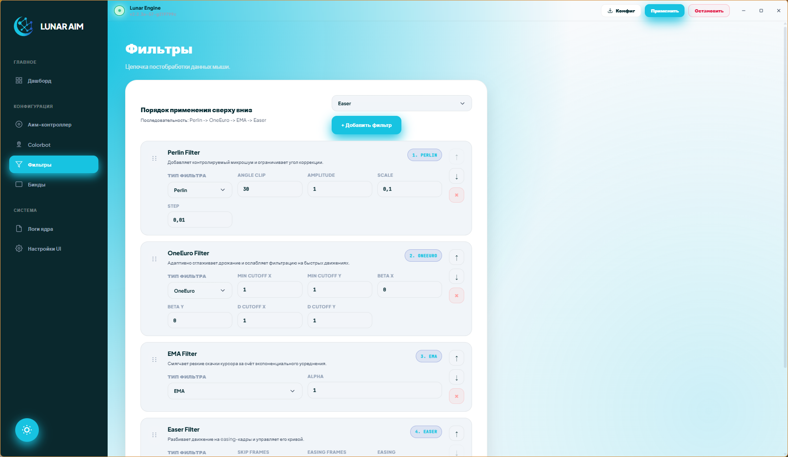
  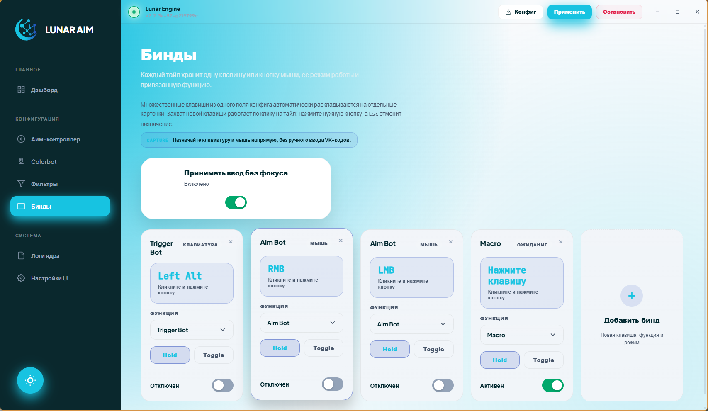
  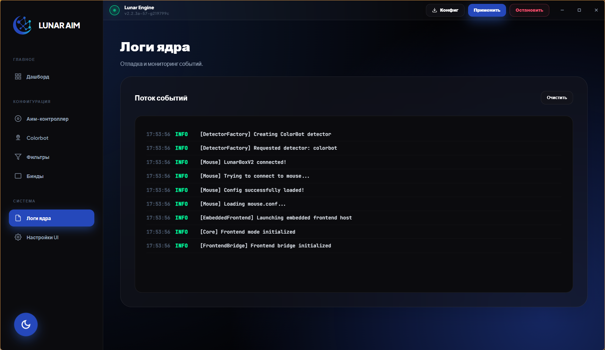
  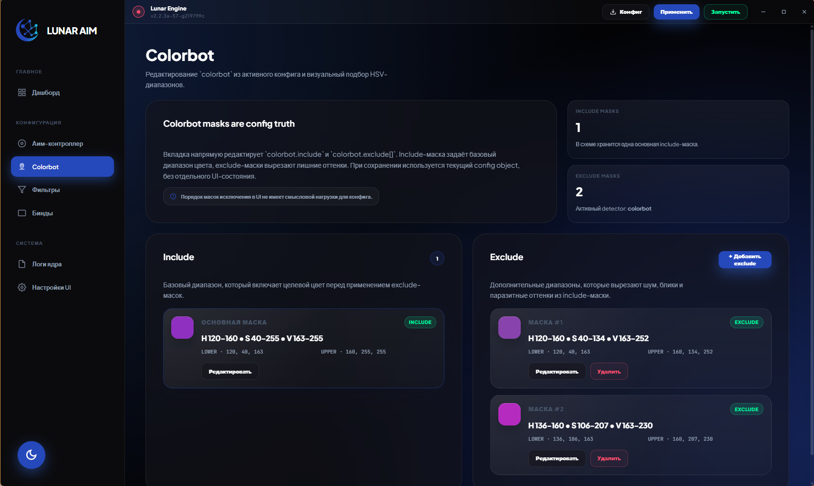
  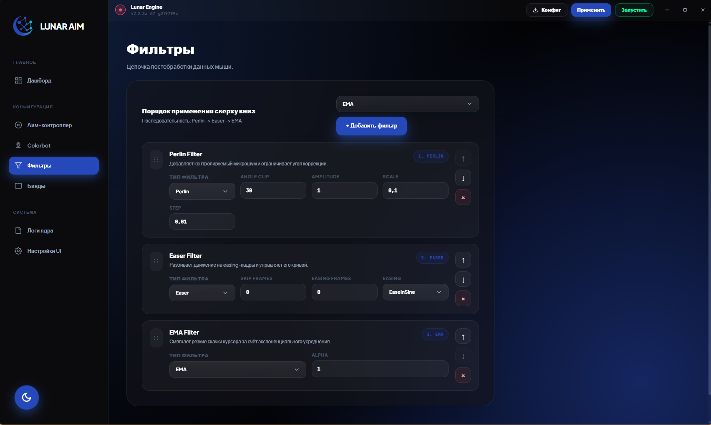
</p>

<details>
<summary>View the remaining interface screens</summary>
<br>

<p align="center">
  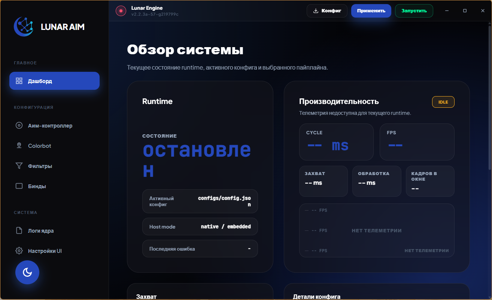
  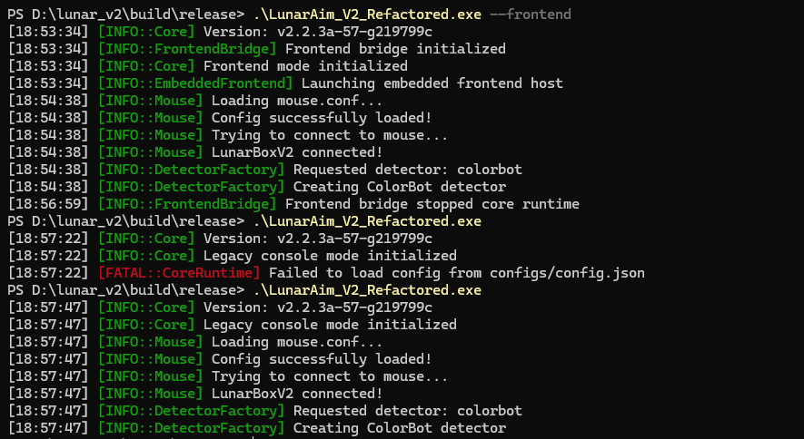
</p>
</details>

## Detection experiment

The repository includes a small, shareable snapshot of the CS2 detector experiment:

- 127 gameplay demos were labeled.
- The model was trained for 150 epochs.
- Training curves, label statistics, and spatial distributions are included for inspection.
- The resulting `yolo11n_cs2.pt` checkpoint is provided as an experiment artifact.

<p align="center">
  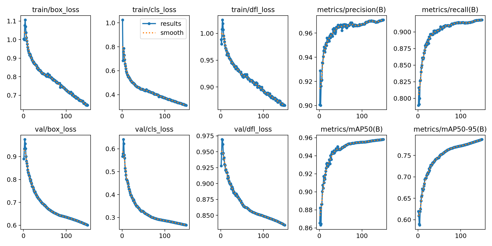
</p>

<p align="center">
  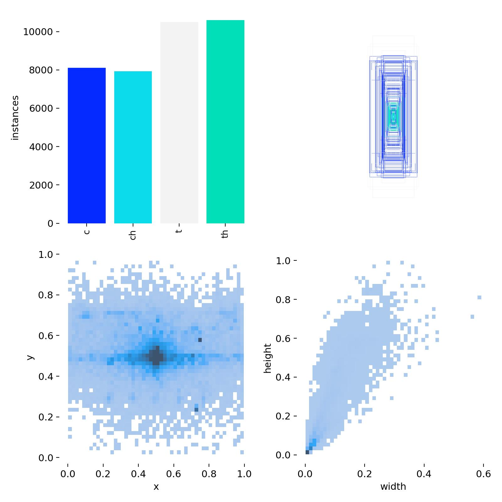
  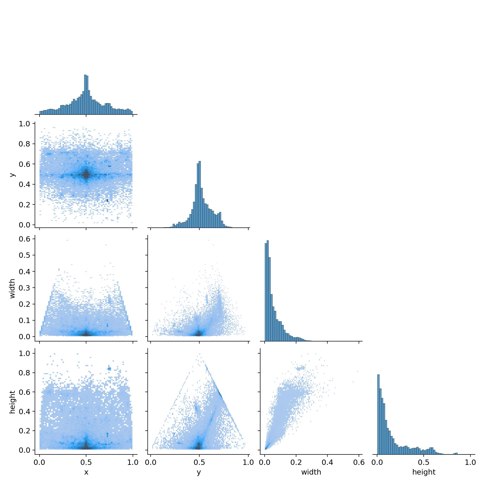
</p>

## Public / private boundary

This is a **showcase repository**, not the Lunar V2 source distribution. It contains the materials that can be shared publicly: architecture notes, design documentation, interface captures, and selected ML artifacts. Private runtime code, production integrations, credentials, and proprietary infrastructure are intentionally excluded.

## Repository layout

```text
.
├── assets/
│   ├── brand/          # logos and presentation cover
│   └── screenshots/    # named UI captures
├── docs/               # presentation and public project notes
├── experiments/
│   └── yolo-cs2/       # detector metrics, plots, and checkpoint
└── README.md
```

## Materials

- [Architecture and project presentation](docs/Lunar.pdf)
- [Project description](docs/project-description.md)
- [Interface screenshots](assets/screenshots/)
- [CS2 detector experiment](experiments/yolo-cs2/)

<br>

<div align="center">
  <sub>LunarAim 2.2 · native interface for a modular runtime</sub>
</div>
