<p align="center">
  <a href="https://t.me/lunaraim2">
    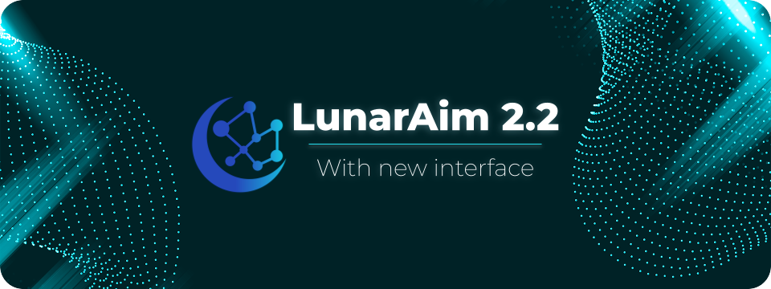
  </a>
</p>

<p align="center">
  <a href="https://t.me/in_the_skyyy"></a>
  <a href="https://t.me/lunaraim"></a>
  <a href="https://t.me/lunaraim2"></a>
</p>

<p align="center"><a href="README.md">English</a> · <a href="README.ru-RU.md">Русский</a> · <a href="README.zh-CN.md">简体中文</a></p>

<h3 align="center">Создано с помощью</h3>

<p align="center">
  <a href="https://developer.microsoft.com/en-us/microsoft-edge/webview2/"></a>
  <a href="https://learn.microsoft.com/en-us/windows/win32/"></a>
  <a href="https://cmake.org/"></a>
  <a href="https://visualstudio.microsoft.com/vs/features/cplusplus/"></a>
  <a href="https://developer.nvidia.com/cuda-toolkit"></a>
  <a href="https://developer.nvidia.com/tensorrt"></a>
  <a href="https://pytorch.org/"></a>
  <a href="https://github.com/ultralytics/ultralytics"></a>
</p>

<details>
<summary>Содержание</summary>
<br>

- [Что показывает репозиторий](#что-показывает-репозиторий)
- [Архитектура](#архитектура)
  - [Границы runtime](#границы-runtime)
  - [Что нового](#что-нового)
- [Галерея интерфейса](#галерея-интерфейса)
  - [Дашборд runtime](#дашборд-runtime)
  - [Настройка детектора](#настройка-детектора)
  - [Инструменты runtime](#инструменты-runtime)
- [Эксперимент с детекцией](#эксперимент-с-детекцией)
- [Публичная и закрытая часть](#публичная-и-закрытая-часть)
- [Материалы](#материалы)

</details>

> **Публичный обзор** Lunar V2: границы runtime, интеграция frontend, визуальный язык и эксперимент с компьютерным зрением. Production-приложение и его реализация остаются закрытыми.

## Что показывает репозиторий

LunarAim 2.2 — нативное Windows-приложение с компактным наблюдаемым runtime-ядром. Интерфейс работает как клиент backend через структурированный bridge, а платформозависимый ввод и GPU-функциональность скрыты за явными границами.

- **CoreRuntime** управляет запуском, выполнением, остановкой, конфигурацией, snapshot-состояниями и telemetry.
- **Frontend Bridge** предоставляет встроенному UI структурированный native API.
- **Компонуемые контракты** позволяют независимо заменять aim, detection, trigger и mouse output.
- **Изолированные платформенные модули** разделяют Win32 Raw Input и CUDA / TensorRT runtime.
- **Инструменты оператора** показывают состояние runtime, производительность, конфигурацию, фильтры, binds и логи.

## Архитектура

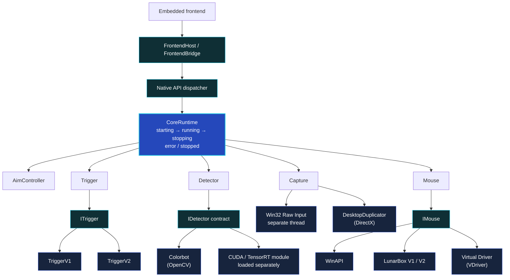

### Границы runtime

Runtime разделён на явные границы, чтобы каждая часть могла развиваться независимо от деталей реализации верхних уровней.

- **`CoreRuntime`.** Владеет жизненным циклом, worker thread, путём к конфигурации, snapshot-состояниями и telemetry производительности.
- **`FrontendBridge`.** Преобразует UI-запросы в стабильный native API через dispatcher и handlers.
- **`IDetector`.** Отделяет aim-логику от реализации детектора, включая Color и CUDA-пути.
- **`ITrigger`.** Отделяет orchestration runtime от механизма срабатывания.
- **`IMouse`.** Отделяет прикладную логику от способа отправки mouse-команд.
- **Raw Input module.** Выполняет сбор Win32-ввода в отдельном потоке и через собственную границу состояния.
- **CUDA runtime module.** Выносит зависимости CUDA / TensorRT из основного executable в отдельно загружаемый GPU-модуль.

### Что нового

LunarAim 2.2 собирает основные runtime-задачи в единый наблюдаемый поток. Встроенный frontend общается через структурированный bridge, а не обращается к внутренним деталям напрямую; `CoreRuntime` задаёт единый жизненный цикл запуска, работы, остановки и обработки ошибок.

Контракты runtime упрощают расширение системы: aim control, detection, triggering и mouse output можно заменять независимо. Платформенная логика также изолирована: Win32 Raw Input работает через собственную границу состояния, а CUDA / TensorRT загружается как отдельный GPU-модуль.

Конфигурация, snapshot runtime, telemetry производительности и логи стали самостоятельными частями operator experience. UI показывает текущее состояние системы, оставляя конкретные реализации за ясными интерфейсами.

## Галерея интерфейса

UI задуман как операторская панель runtime с отдельными представлениями состояния, детекции, поведения ввода и диагностики.

### Дашборд runtime

Дашборд сразу показывает состояние runtime, активную конфигурацию, frame timing, FPS и telemetry.

<p align="center">
  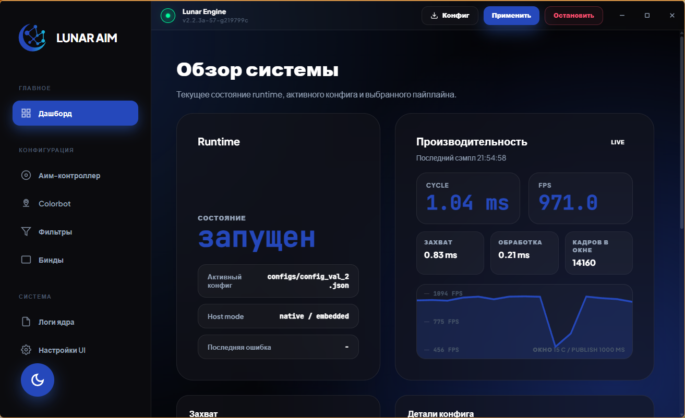
  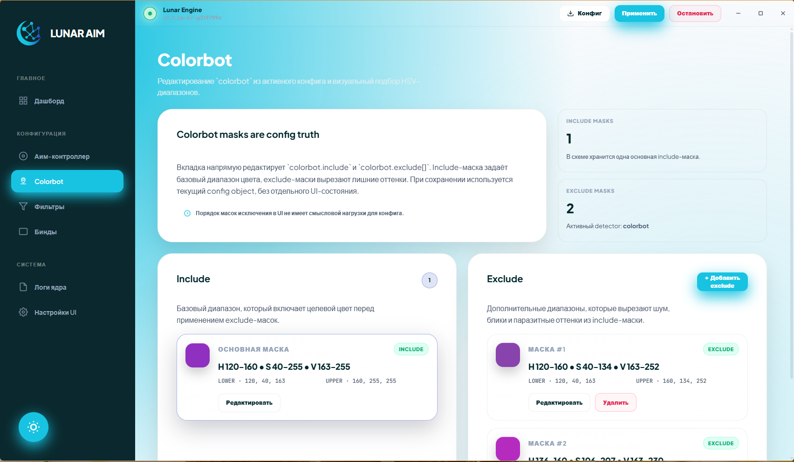
</p>

### Настройка детектора

<p align="center">
  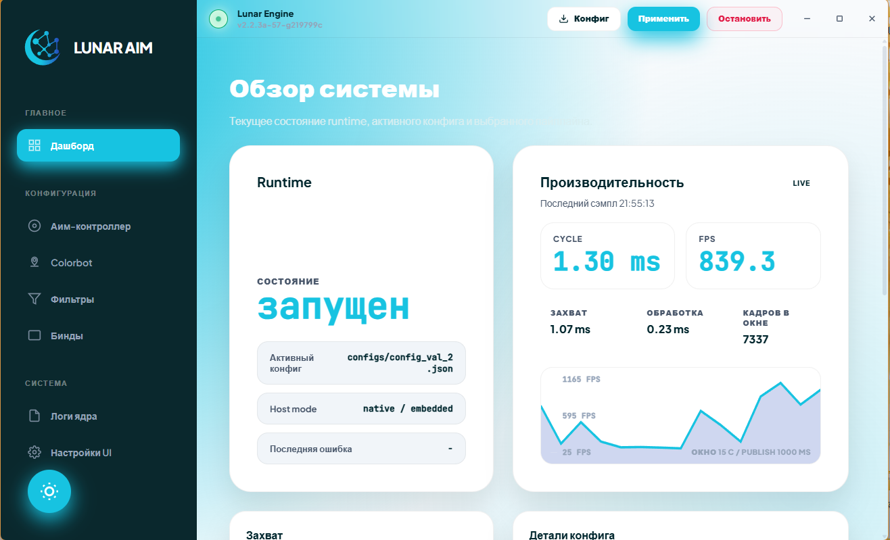
  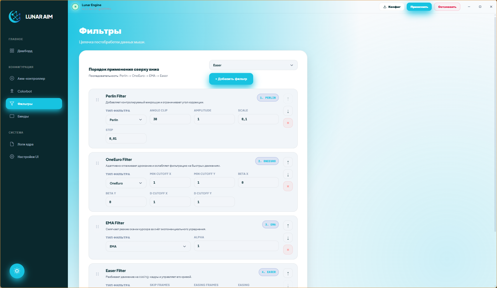
</p>

### Инструменты runtime

<p align="center">
  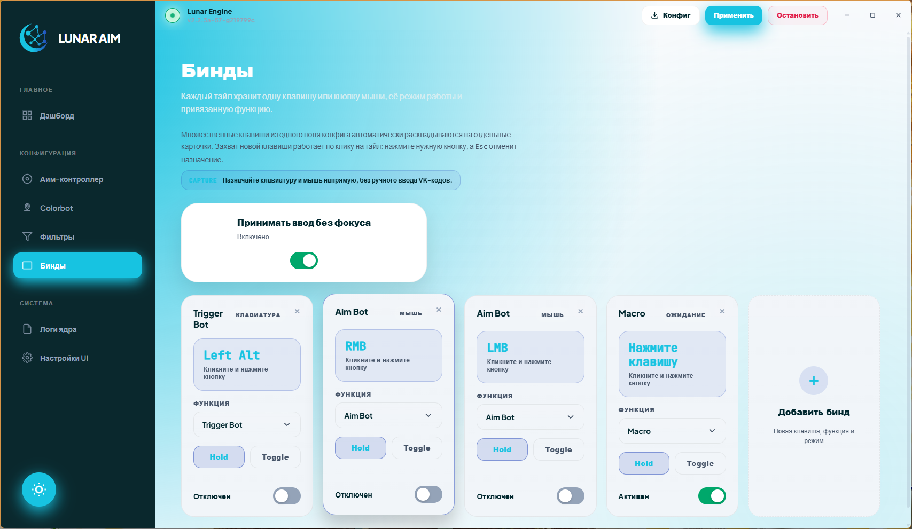
  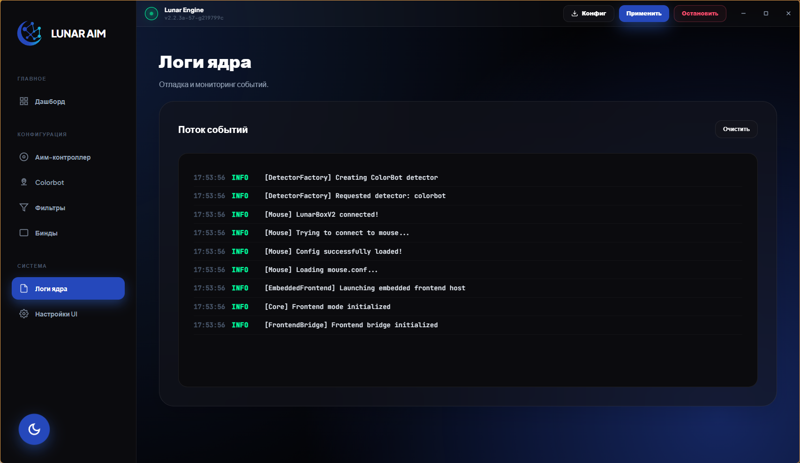
</p>

<details>
<summary>Дополнительные экраны интерфейса</summary>
<br>

<p align="center">
  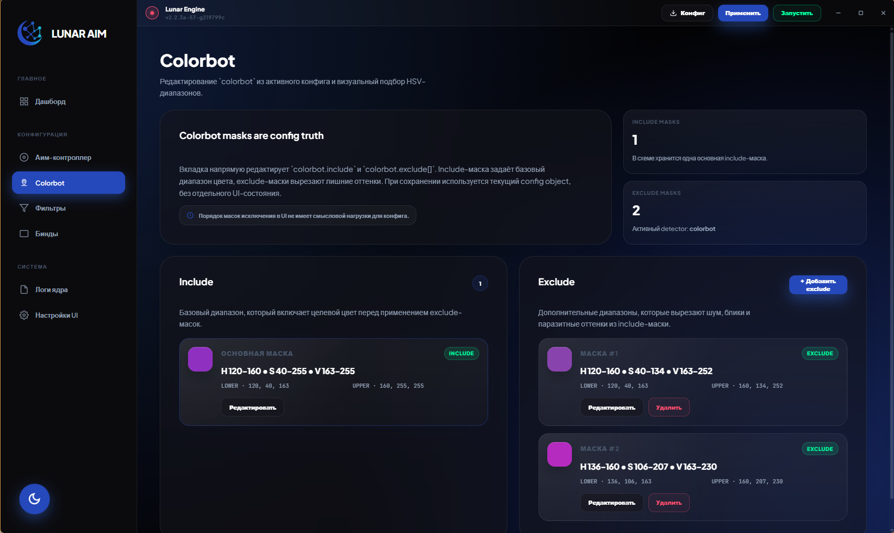
  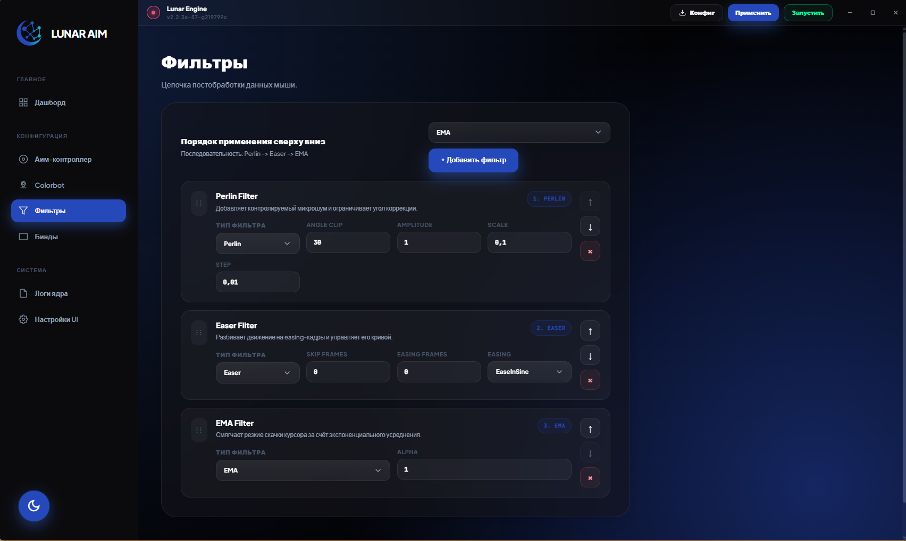
  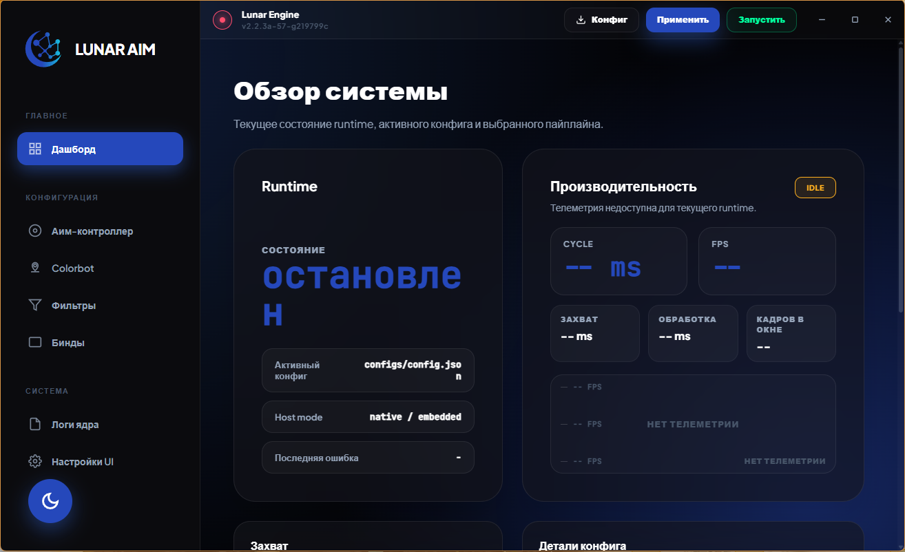
  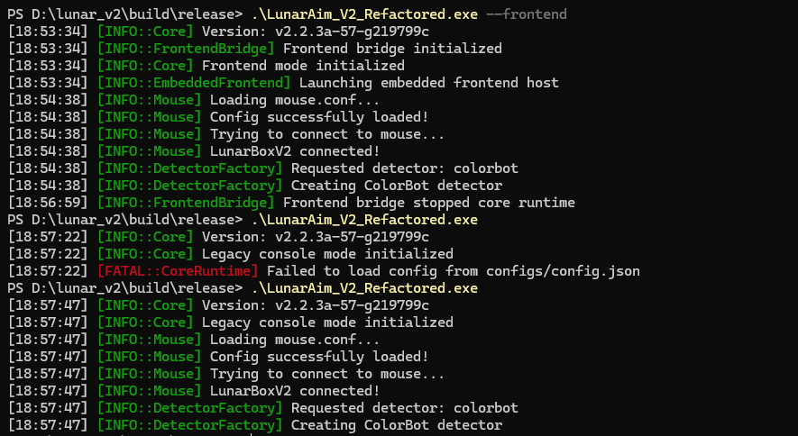
</p>
</details>

## Эксперимент с детекцией

В репозитории сохранён небольшой публичный snapshot эксперимента с детектором для CS2:

- размечено 127 игровых демок;
- модель обучалась 150 эпох;
- сохранены графики обучения, статистика разметки и пространственные распределения;
- checkpoint `yolo11n_cs2.pt` добавлен как артефакт эксперимента.

<p align="center">
  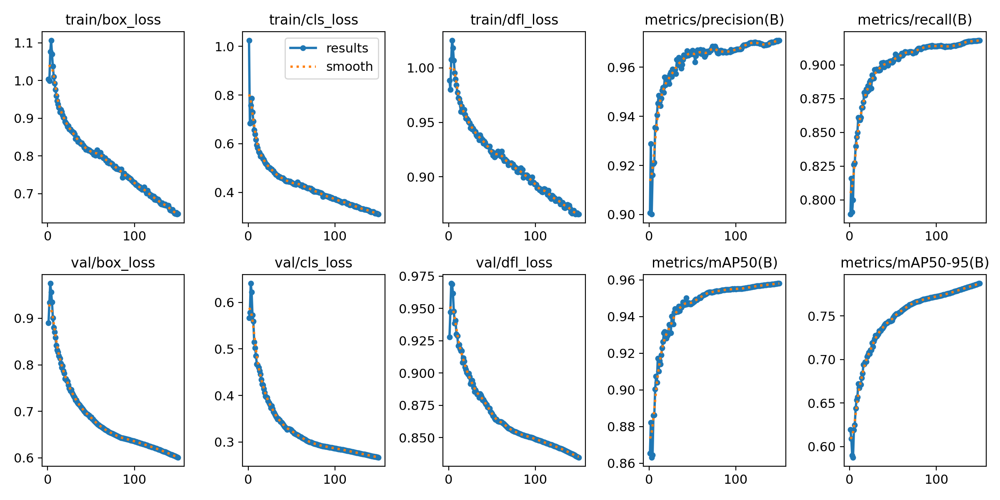
</p>

<p align="center">
  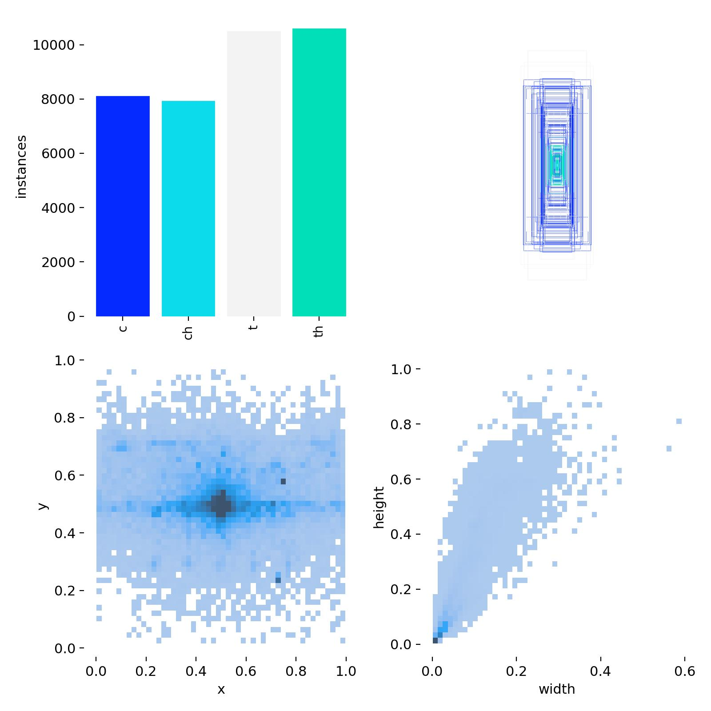
  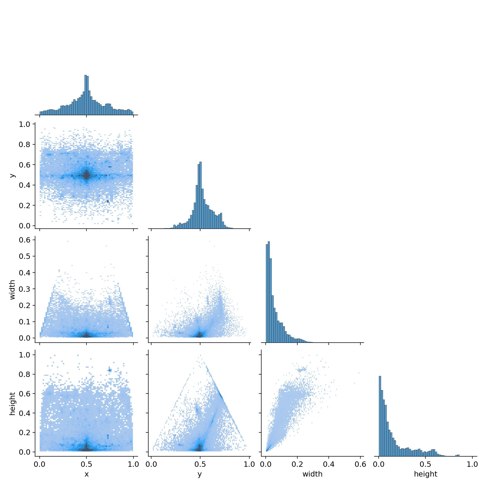
</p>

## Публичная и закрытая часть

Это **showcase-репозиторий**, а не дистрибутив исходников Lunar V2. Здесь опубликованы архитектурные материалы, design documentation, снимки интерфейса и отдельные ML-артефакты. Production-код, приватные интеграции, credentials и proprietary infrastructure намеренно исключены.

<details>
<summary>Структура репозитория</summary>
<br>

```text
.
├── assets/
│   ├── brand/          # логотипы и обложка презентации
│   └── screenshots/    # именованные снимки UI
├── docs/               # презентация и публичные заметки
├── experiments/
│   └── yolo-cs2/       # метрики, графики и checkpoint детектора
└── README.md
```

</details>

## Материалы

- [Презентация об архитектуре](docs/Lunar.pdf)
- [Описание проекта](docs/project-description.md)
- [Скриншоты интерфейса](assets/screenshots/)
- [Эксперимент с CS2-детектором](experiments/yolo-cs2/)

<br>

<div align="center">
  <picture>
    <source media="(prefers-color-scheme: dark)" srcset="assets/brand/LunAimW.svg">
    <source media="(prefers-color-scheme: light)" srcset="assets/brand/LunAimB.svg">
    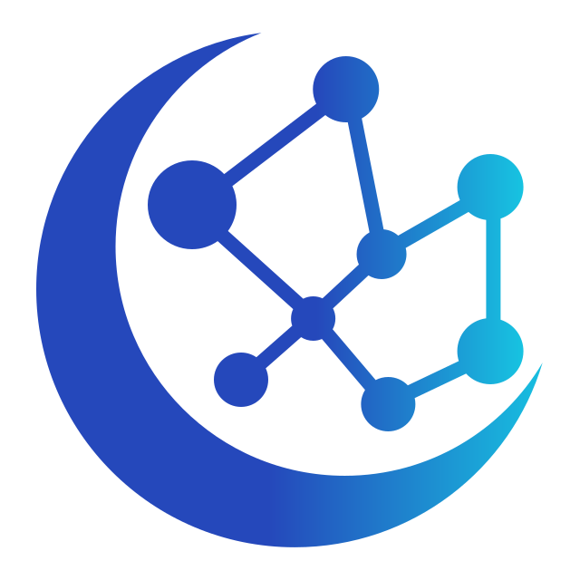
  </picture>
  <h2>LunarAim 2.2</h2>
  <sub>Архитектура native runtime · структурированный UI bridge · GPU-детекция · 2026</sub>
</div>
