<p align="center">
  <a href="https://t.me/lunaraim2">
    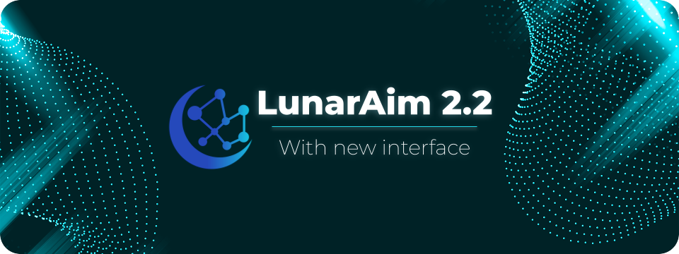
  </a>
</p>

<p align="center">
  <a href="https://t.me/in_the_skyyy"></a>
  <a href="https://t.me/lunaraim"></a>
  <a href="https://t.me/lunaraim2"></a>
</p>

<p align="center"><a href="README.md">English</a> · <a href="README.ru-RU.md">Русский</a> · <a href="README.zh-CN.md">简体中文</a></p>

<h3 align="center">构建技术</h3>

<p align="center">
  <a href="https://developer.microsoft.com/en-us/microsoft-edge/webview2/"></a>
  <a href="https://learn.microsoft.com/en-us/windows/win32/"></a>
  <a href="https://cmake.org/"></a>
  <a href="https://visualstudio.microsoft.com/vs/features/cplusplus/"></a>
  <a href="https://developer.nvidia.com/cuda-toolkit"></a>
  <a href="https://developer.nvidia.com/tensorrt"></a>
  <a href="https://pytorch.org/"></a>
  <a href="https://github.com/ultralytics/ultralytics"></a>
</p>

<details>
<summary>目录</summary>
<br>

- [本仓库展示的内容](#本仓库展示的内容)
- [架构](#架构)
  - [Runtime 边界](#runtime-边界)
  - [新增内容](#新增内容)
- [界面画廊](#界面画廊)
  - [Runtime 仪表盘](#runtime-仪表盘)
  - [检测器配置](#检测器配置)
  - [Runtime 工具](#runtime-工具)
- [检测实验](#检测实验)
- [公开与私有边界](#公开与私有边界)
- [项目资料](#项目资料)

</details>

> **公开技术概览**：介绍 Lunar V2 的 runtime 边界、前端集成、视觉语言以及计算机视觉实验。生产应用及其实现仍为私有内容。

## 本仓库展示的内容

LunarAim 2.2 是一个采用原生 Windows 技术构建的应用，围绕一个小型、可观测的 runtime 核心组织。界面通过结构化 bridge 作为 backend 的客户端运行，平台相关的输入和 GPU 功能则被隔离在明确的边界之后。

- **CoreRuntime** 负责启动、运行、停止、配置、状态快照和 telemetry。
- **Frontend Bridge** 为嵌入式 UI 提供结构化 native API。
- **可组合的契约** 使 aim、detection、trigger 和 mouse output 可以独立替换。
- **隔离的平台模块** 将 Win32 Raw Input 与 CUDA / TensorRT runtime 分开。
- **操作工具** 展示 runtime 状态、性能、配置、filters、binds 和日志。

## 架构

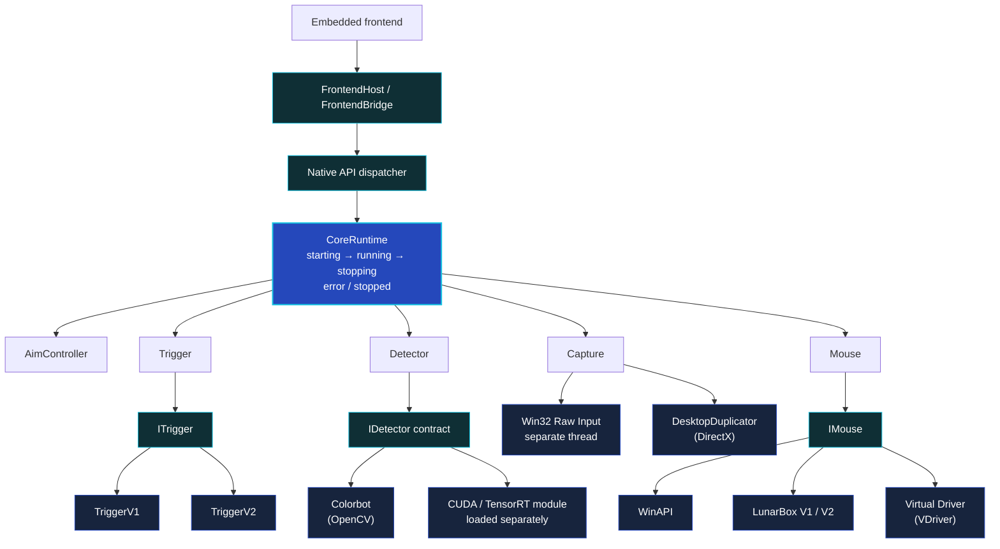

### Runtime 边界

Runtime 被拆分为明确的边界，使每个部分都可以演进，而不会把实现细节泄漏到上层。

- **`CoreRuntime`。** 负责生命周期、worker thread、配置路径、状态快照和性能 telemetry。
- **`FrontendBridge`。** 通过 dispatcher 和 handler 将 UI 请求转换为稳定的 native API。
- **`IDetector`。** 将 aim 逻辑与检测器实现解耦，包括 Color 和 CUDA 路径。
- **`ITrigger`。** 将 runtime orchestration 与触发机制解耦。
- **`IMouse`。** 将应用逻辑与鼠标命令的发送方式解耦。
- **Raw Input module。** 通过独立线程和自身的状态边界收集 Win32 输入。
- **CUDA runtime module。** 将 CUDA / TensorRT 依赖放在单独加载的 GPU 模块中，不污染主 executable。

### 新增内容

LunarAim 2.2 将主要的 runtime 关注点整合为一条可观测的流程。嵌入式 frontend 通过结构化 bridge 通信，而不是直接访问内部实现；`CoreRuntime` 为启动、运行、停止和错误处理提供统一的生命周期。

Runtime 契约使系统更容易扩展：aim control、detection、triggering 和 mouse output 都可以独立替换。平台相关功能也被隔离：Win32 Raw Input 拥有独立的状态边界，CUDA / TensorRT 作为单独的 GPU 模块加载，而不是成为主 executable 的硬依赖。

配置、runtime 快照、性能 telemetry 和日志都是 operator experience 的一等组成部分。UI 专注于展示系统当前状态，具体实现则隐藏在清晰的接口之后。

## 界面画廊

UI 被设计为 runtime 的操作面板，并通过独立页面展示状态、检测、输入行为和诊断信息。

### Runtime 仪表盘

仪表盘直接展示 runtime 状态、当前配置、frame timing、FPS 和 telemetry。

<p align="center">
  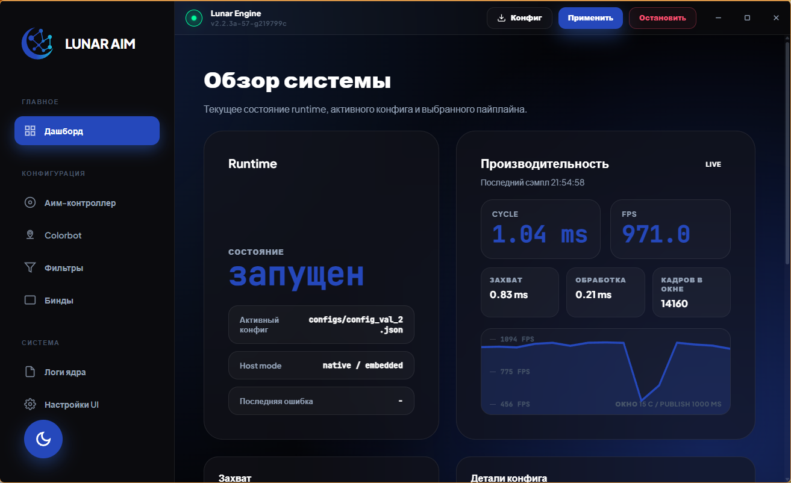
  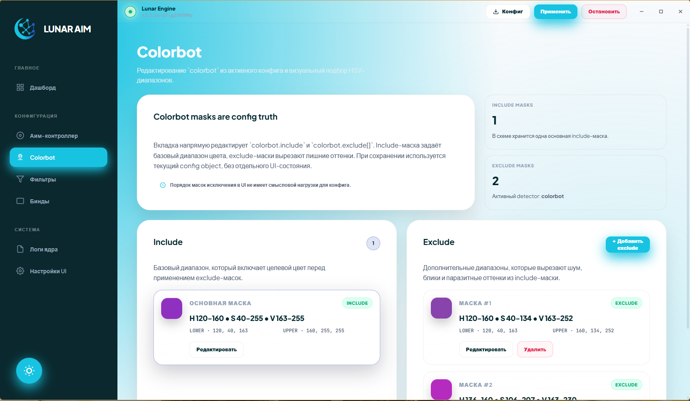
</p>

### 检测器配置

<p align="center">
  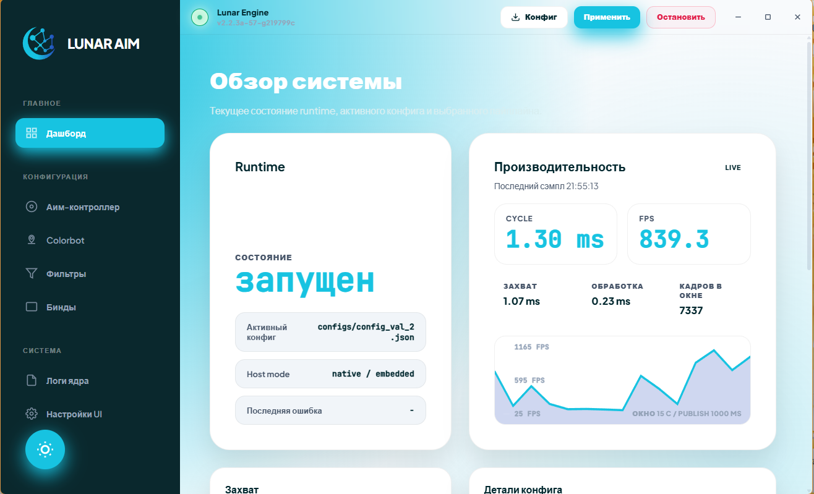
  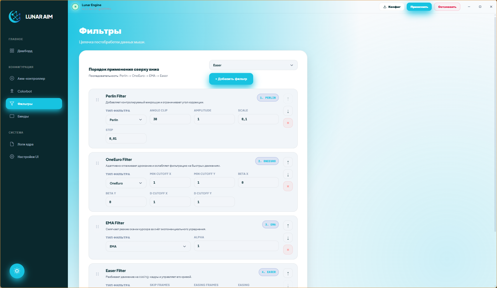
</p>

### Runtime 工具

<p align="center">
  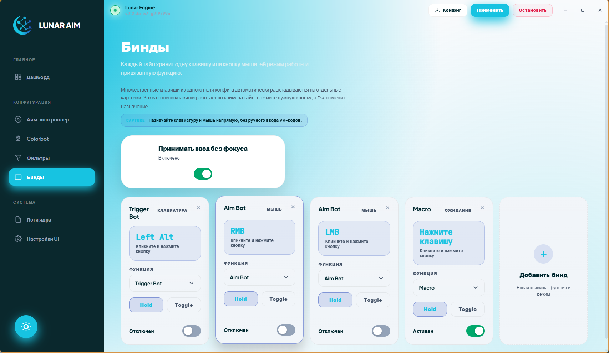
  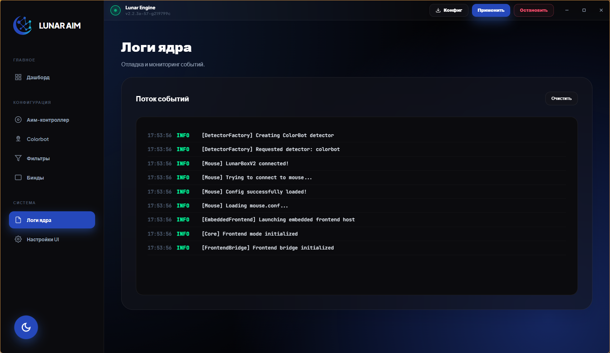
</p>

<details>
<summary>更多界面截图</summary>
<br>

<p align="center">
  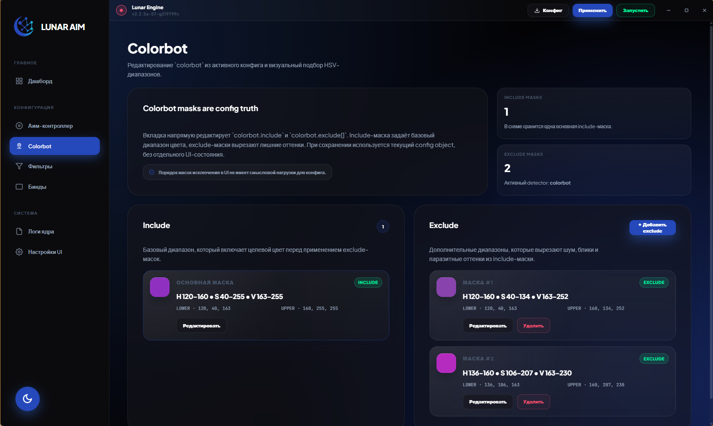
  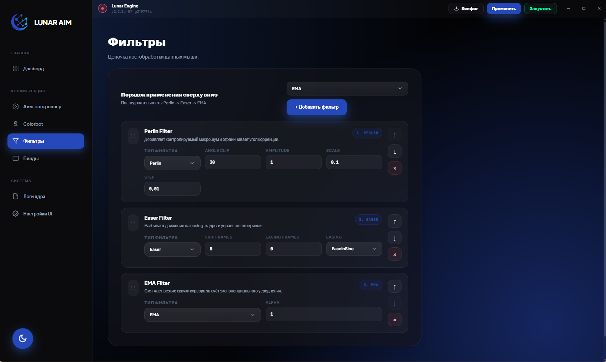
  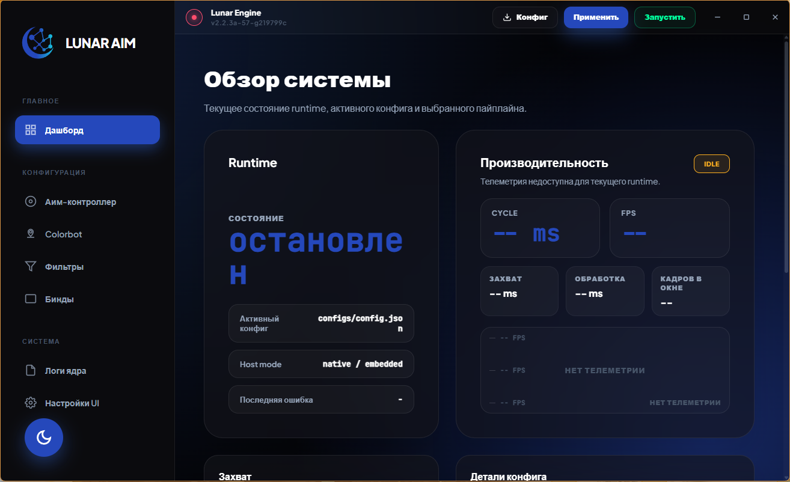
  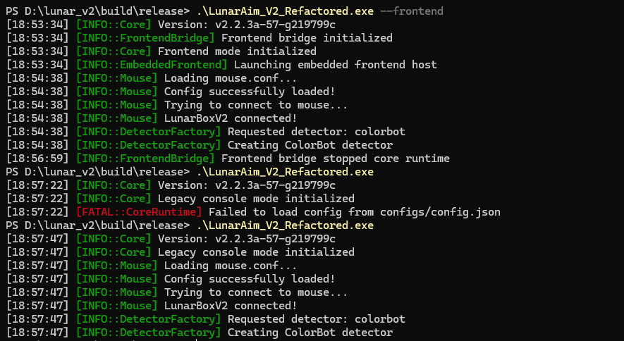
</p>
</details>

## 检测实验

仓库包含一份可公开分享的 CS2 检测器实验 snapshot：

- 标注了 127 个游戏 demo；
- 模型训练了 150 个 epoch；
- 保存了训练曲线、标注统计和空间分布；
- `yolo11n_cs2.pt` checkpoint 作为实验产物提供。

<p align="center">
  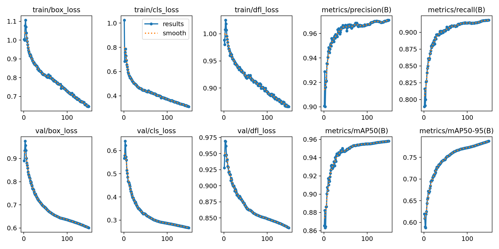
</p>

<p align="center">
  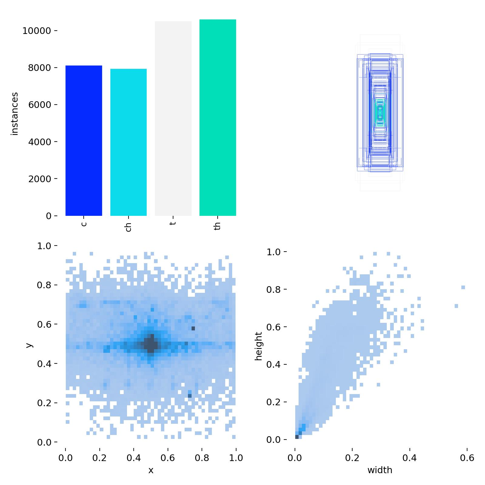
  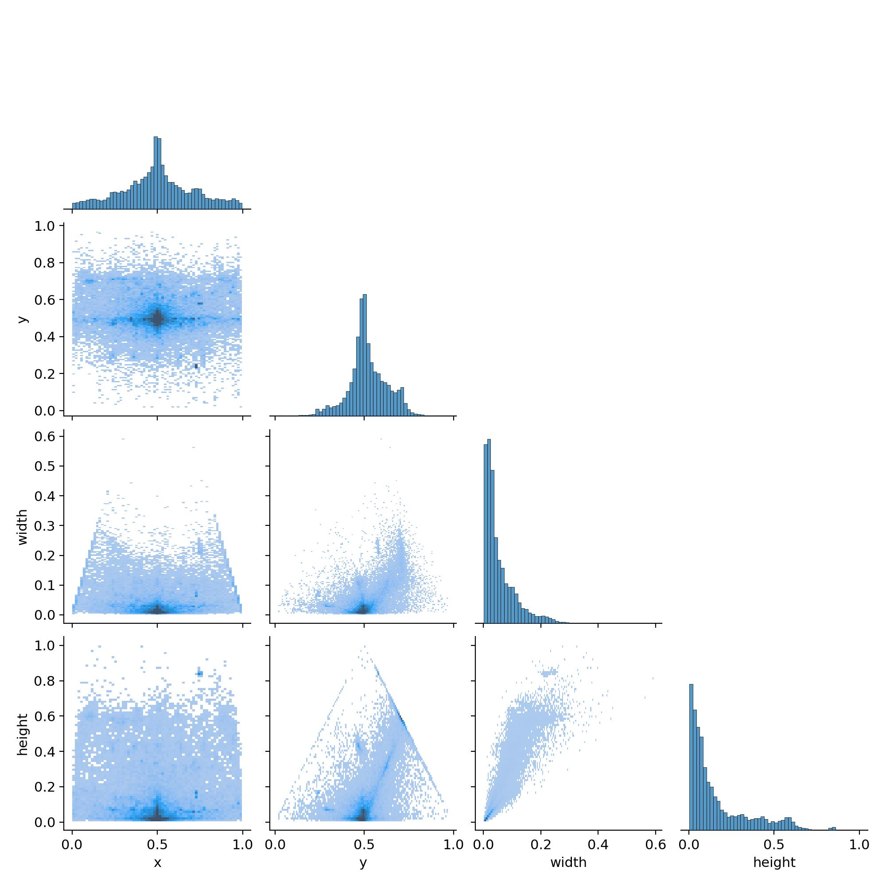
</p>

## 公开与私有边界

这是一个 **showcase 仓库**，而不是 Lunar V2 源代码发行版。公开内容包括架构资料、设计文档、界面截图和选定的 ML 产物。私有 runtime 代码、生产集成、凭据和 proprietary infrastructure 均被有意排除。

<details>
<summary>仓库结构</summary>
<br>

```text
.
├── assets/
│   ├── brand/          # logo 和演示封面
│   └── screenshots/    # 命名后的 UI 截图
├── docs/               # 演示文稿和公开项目说明
├── experiments/
│   └── yolo-cs2/       # 检测器指标、图表和 checkpoint
└── README.md
```

</details>

## 项目资料

- [架构演示文稿](docs/Lunar.pdf)
- [项目说明](docs/project-description.md)
- [界面截图](assets/screenshots/)
- [CS2 检测实验](experiments/yolo-cs2/)

<br>

<div align="center">
  <picture>
    <source media="(prefers-color-scheme: dark)" srcset="assets/brand/LunAimW.svg">
    <source media="(prefers-color-scheme: light)" srcset="assets/brand/LunAimB.svg">
    
  </picture>
  <h2>LunarAim 2.2</h2>
  <sub>原生 runtime 架构 · 结构化 UI bridge · GPU 检测</sub>
</div>
